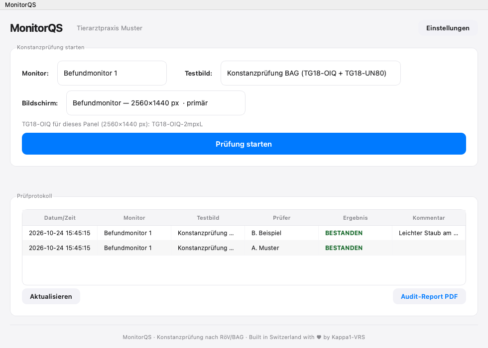

# MonitorQS

**Visuelle Konstanzprüfung von Befundmonitoren nach BAG-Wegleitung, für Tierarztpraxen und Kliniken in der Schweiz.**
*Visual constancy testing of diagnostic displays following the Swiss FOPH guideline — English summary below.*



Die Röntgenverordnung verlangt für Befundmonitore eine regelmässige Konstanzprüfung. MonitorQS führt sie
nach der **BAG-Wegleitung «Befundmonitore» V3 (20.03.2025), Tabelle C** durch und führt das Logbuch dazu:

1. **TG18-OIQ** in der grössten Variante, die 1:1 (Pixel für Pixel) auf das gewählte Panel passt — auch auf
   Retina-Bildschirmen. Abgehakt werden die Kriterien 8.2.2 a, b, c, e und g; das Kriterium für das schwarze
   Feld richtet sich nach der Raumklasse (RK1–RK3) des Monitors.
2. **TG18-UN80**, bildschirmfüllend (DDL 204), für Homogenität (8.2.4) und Farbeindruck (8.2.5).
3. Bestanden nur, wenn alle sieben Kriterien erfüllt sind. Ergebnis, prüfende Person und Kommentar landen im
   Logbuch; der **Audit-Report (PDF)** listet je Prüfung jedes Einzelkriterium — fürs Anlagenbuch.

Dazu: mehrere Monitore mit Auflösung und Raumklasse, automatische Wahl des passenden Bildschirms,
wöchentliche Erinnerung (Donnerstag 09:00, nur wenn in der Woche noch nicht geprüft), TG18-QC als Einzelbild.
`H` blendet während der Prüfung die Leisten aus.

## Installation

[Neuestes Release](../../releases/latest) laden, `MonitorQS.dmg` öffnen, App in den Programme-Ordner ziehen.
Voraussetzung: **Mac mit Apple Silicon, macOS 13 oder neuer.**

Die App ist nicht notarisiert. macOS blockiert deshalb den ersten Start; unter
*Systemeinstellungen › Datenschutz & Sicherheit* «Dennoch öffnen» wählen.

## Testmuster (AAPM TG18)

Die TG18-Muster sind urheberrechtlich geschützt (AAPM) und werden **nicht mitgeliefert**. Beim ersten Start
lädt MonitorQS sie auf Knopfdruck einmalig und unverändert von den
[Duke RAI Labs](https://rai.labs.duke.edu/resources/tg-18-assessment-of-display-performance-for-medical-imaging-systems/)
(ca. 1 MB), prüft sie per SHA-256 und legt sie mit Quellenangabe ab. Die Prüfung selbst läuft danach ohne Netz.
Die UN80-Fläche erzeugt die App selbst.

> Samei E, Badano A, Chakraborty D, et al. Assessment of Display Performance for Medical Imaging Systems,
> Report of the American Association of Physicists in Medicine (AAPM) Task Group 18, Medical Physics Publishing,
> Madison, WI, AAPM On-Line Report No. 03, April 2005.

## Daten

Alles bleibt auf dem Mac, nichts wird übertragen (einzige Verbindung: der einmalige Download der Testmuster).

| Was | Wo |
|---|---|
| Einstellungen, Monitore, Logbuch (SQLite), Testmuster | `~/Library/Application Support/MonitorQS/` |
| Audit-Reports | `~/Documents/MonitorQS/Berichte/` |
| Erinnerung | `~/Library/LaunchAgents/vet.kappa1.monitorqs.wochenreminder.plist` |

## Grenzen — bitte lesen

- MonitorQS ist **kein Medizinprodukt** und keine behördlich anerkannte Prüfsoftware. Es unterstützt die
  visuelle Konstanzprüfung; ob Ihre Prüfung den Anforderungen genügt, verantworten Sie bzw. Ihre Aufsichtsbehörde.
- Es **ersetzt nicht** die Abnahme- und Zustandsprüfung mit Messgerät (Leuchtdichte, Umgebungslicht).
- Das Logbuch ist eine gewöhnliche SQLite-Datei; Reports sind nicht manipulationssicher.
- Benutzeroberfläche nur auf Deutsch.

## Aus dem Quelltext bauen

```bash
python3 -m pip install PyQt6 pydicom numpy reportlab Pillow certifi pyinstaller
python3 main.py          # direkt starten
bash build.sh            # App + DMG nach dist/ (Pfad zu Python in build.sh anpassen)
```

## Lizenz

GPL-3.0 — siehe [LICENSE](LICENSE). © 2026 Kappa1-VRS GmbH, Zürich.
Verwendet PyQt6 (GPL-3.0), pydicom (MIT), NumPy (BSD), ReportLab (BSD), Pillow (MIT-CMU), certifi (MPL-2.0).
Unabhängiges Projekt, nicht verbunden mit AAPM, Duke University oder dem BAG.

---

## English summary

MonitorQS is a macOS app for the **visual constancy test of diagnostic displays** as required by the Swiss
Federal Office of Public Health (FOPH/BAG) guideline for diagnostic monitors (V3, table C). It shows the
AAPM **TG18-OIQ** pattern pixel-for-pixel on the selected panel (largest size that fits, Retina-aware) and a
full-screen **TG18-UN80** field, walks through the seven pass/fail criteria, keeps a local logbook and
exports a per-criterion **audit PDF**. Weekly reminder included.

The TG18 patterns are © AAPM and are **not bundled**: on first launch the app downloads them unmodified from
Duke RAI Labs (≈ 1 MB), verifies their SHA-256 and stores them with the citation above. Nothing else ever
leaves the Mac. Apple Silicon, macOS 13+. User interface in German only.

Not a medical device; it does not replace acceptance/status testing with a photometer. Licence: GPL-3.0.
